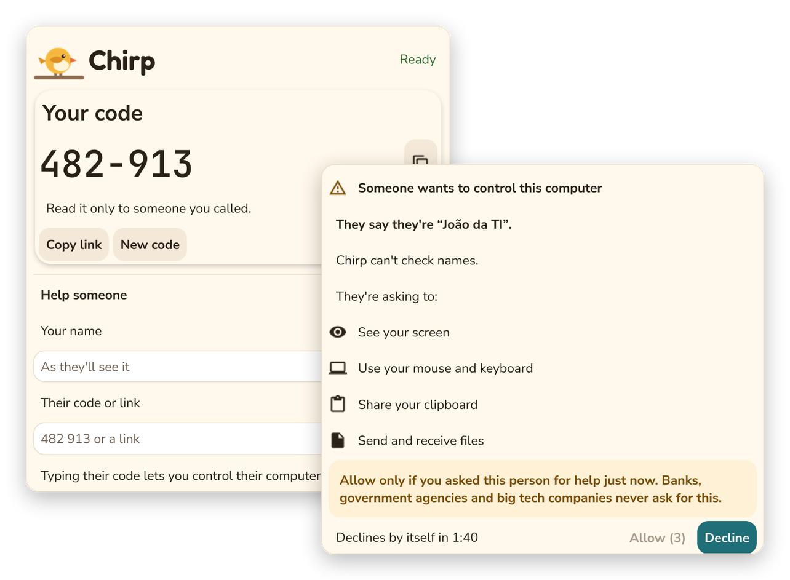

<div align="center">


# Chirp — remote help

**Download it, run it, send your chirp.**

Remote help between two people who trust each other. Nothing to install, no
account, and nothing happens on your screen until you press *Allow*.

**[usechirp.app](https://usechirp.app)** ·
[How Chirp works](docs/product-model.md) ·
[Roadmap](https://github.com/orgs/barahn/projects/2)

[](LICENSE)
[](https://github.com/barahn/chirp/actions/workflows/ci.yml)
[](https://github.com/barahn/chirp/actions/workflows/codeql.yml)

</div>

> [!IMPORTANT]
> **Chirp is not ready to use yet.** Two Chirps find each other, the consent
> prompt works, and an allowed session shows the other screen and takes
> input, but it has not been tried between two real machines yet and there is
> nothing to download. [Status](#status) says exactly where it stands.

<p align="center">
  <picture>
    <source media="(prefers-color-scheme: dark)" srcset="docs/images/chirp-dark.png">
    
  </picture>
  <br>
  <sub>The current build: a machine's code, and the prompt it shows when someone types that code.</sub>
</p>

## How it works

1. **Run Chirp.** It is one program, the same for everyone: no installer, no
   account, no technician edition. It shows your chirp — a short code — and a
   link you can send instead.
2. **Send your chirp to someone you trust.** Read them the code, or send them
   the link. They type the code into their own Chirp, or paste the link. Every
   use of the link makes a fresh single-use code, so a code that leaks after it
   was used opens nothing.
3. **You decide.** Your Chirp asks you, on your own screen, who is asking and
   for what. Nothing starts until you press *Allow*.

Whoever types the code controls; whoever shared it decides. Chirp is for
one-off help — a relative, a friend, a customer on the phone — not for
managing a fleet: nothing stays installed to be managed.
[How Chirp works](docs/product-model.md) is the full description.

## A prompt that is easy to say no to

Remote-support tools are a favourite of phone scammers, and a friendly prompt
does their work for them. Chirp's consent prompt is plain on purpose, and
built so that an unexpected request is easy to decline:

- *Decline* has the focus, and *Allow* only becomes clickable after three
  seconds, so neither a reflexive Enter nor a stray click lets anyone in.
- The caller's name is shown as a claim — *They say they're…* — because Chirp
  cannot check names, and it is cleaned so it cannot pose as a line of the
  prompt.
- Every permission is spelled out, under a fixed warning that banks,
  government agencies and big tech companies never ask for this.
- Closing the prompt, or letting it run out of time, declines.

## What you can count on

Three commitments bind what Chirp may become. They are constraints, not
features to be traded away:

- **No feature gates.** Screen sharing, input control, multi-monitor, file
  transfer and clipboard sync are the free core, permanently.
- **Explicit consent.** A session cannot start without the end user agreeing to
  it on their own machine, in a prompt Chirp controls.
- **Self-hostable with zero restrictions.** Anyone may run their own signalling
  and relay infrastructure. Any hosted service is a convenience, never a
  requirement.

And Chirp never:

- installs itself, or starts with your computer;
- reads your clipboard unless you paste.

Quitting Chirp cancels your code and link at once. If it can't reach its
server as it closes, the server drops them on its own, within about two
minutes by default. Until then nobody can get in, because there is no Chirp
left to ask you.

## Status

Chirp is not yet a runnable product.

**Working and tested today:**

- **The `cmd/chirp` app, up to the consent decision** — the one program both
  sides run, in the window above. It shows this machine's code and link, and
  takes someone else's code or pasted link; the other machine then asks its
  user in Chirp's own prompt, and the answer reaches the relay.
- **The relay** — `cmd/chirp-relay`, for a relay you host yourself. It
  matches the two ends of a session and relays their WebRTC signalling.
  Written for Chirp — no multi-tenancy, no RBAC — rather than taken from the
  proprietary Barahn control plane. [docs/relay.md](docs/relay.md) runs it
  behind TLS in a Proxmox LXC container, with Podman, or on any Linux host.
- **The session layer** — codes, share links, the consent rules, and
  per-network limits on guessing codes. Codes, links and the throttle are
  remotekit's `rendezvous` package; the state machine, consent rules and
  values are Chirp's.
- **Signalling over Nostr relays** — optional session negotiation and
  signalling over public Nostr relays with `-nostr` / `CHIRP_NOSTR`, leaving
  the server only code lookup and blind to signalling traffic.

**Not here yet:**

- **A session tried between two machines.** The screen and input go
  through remotekit's `stream` package, and the tests show one Chirp's screen
  decoded in another's through the relay, on one machine. Across two
  machines, and with a Windows owner, is still to do (barahn/chirp#12).
- **Downloads.** There are no builds to download; build from source below.
- **A TURN relay.** Until Chirp ships one, self-hosting means bringing your
  own STUN/TURN (coturn works): see [docs/stun-turn.md](docs/stun-turn.md).
- **A public server.** When Chirp offers one, it will be blind: it finds the
  other machine from the first part of the code, and never sees the rest of
  it or a single signalling message ([decision 5](docs/product-model.md);
  Nostr signalling and the PAKE over the code's secret part are in).

Planned work is in this repository's issues and the
[Chirp roadmap](https://github.com/orgs/barahn/projects/2) project.

### Try it from source

`cmd/chirp` needs cgo, and on Linux the OpenGL, X11 and Wayland headers
(`libgl1-mesa-dev xorg-dev libwayland-dev libxkbcommon-dev` on Debian and
Ubuntu). Start a relay, then two Chirps, and type one's code into the other:

```sh
go run ./cmd/chirp-relay
CHIRP_RELAY=http://localhost:8080 go run ./cmd/chirp
```

## Where Chirp sits

Chirp is one of three repositories, and the one you want depends on what you
are looking for:

- **[remotekit](https://github.com/barahn/remotekit)** (Apache-2.0) is the
  reusable mechanism: screen capture, VP8 encoding, input injection,
  clipboard, file transfer, WebRTC. Chirp consumes it as a dependency rather
  than reimplementing it.
- **Chirp** (AGPL-3.0-only), this repository, is the on-demand support
  product.
- **Fabrintek's commercial fleet platform** is separate and proprietary.

Dependencies point inwards only — Chirp may depend on remotekit, never on the
platform. [ECOSYSTEM.md](ECOSYSTEM.md) states each repository's role, why
each licence is the one it is, and how to decide which repository a change
belongs in.

## Security

Report vulnerabilities privately to
[security@fabrintek.com.br](mailto:security@fabrintek.com.br) — not in a public
issue. See [SECURITY.md](SECURITY.md).

Chirp grants remote control of an end user's machine, so its pipeline treats
that as the threat model rather than an afterthought: every pull request runs
gosec, govulncheck, gitleaks, a third-party licence gate, CodeQL and
dependency review, with every action pinned to a commit SHA, and all of them
are required checks on `develop` and `main`. What each gate is for, and the
repository settings that back it, are in
[docs/devsecops.md](docs/devsecops.md).

## Contributing

Issues and bug reports are welcome. Pull requests from outside Fabrintek will
not be merged yet.

This is deliberate and temporary. Chirp is dual-licensed (see
[LICENSING.md](LICENSING.md)), which works only while Fabrintek holds the
copyright in all of it. Merging a contribution before Contributor License
Agreement acceptance is enforced here would leave code in the tree that
Fabrintek cannot relicense — quietly, and in a way no build or test would
catch. The door stays shut until the CLA is presented and recorded where pull
requests actually arrive. [CONTRIBUTING.md](CONTRIBUTING.md) has the details,
and the branch model for those who work on Chirp.

## Licence

GNU Affero General Public License v3.0 — see [LICENSE](LICENSE).

The AGPL is deliberate: Chirp is network-delivered software, and the AGPL is
what keeps a hosted fork from taking the code without returning changes.

Fabrintek, as sole copyright holder, also licenses Chirp under separate
commercial terms. This does not affect your rights under the AGPL — see
[LICENSING.md](LICENSING.md).
